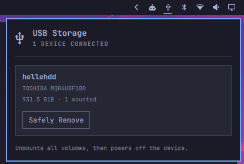

# Omarchy Additions

Small, reusable additions for Omarchy. The first is **USB Storage**, a native
Quickshell panel for safely disconnecting USB storage.

## USB Storage



A USB icon appears beside Bluetooth while external USB storage is connected.
Click it to see drive names, capacity and mount status. Click **Safely Remove**
to unmount every affected volume and power off the device. Wait for the
**Safe to unplug** notification before disconnecting it.

Keyboard: Up/Down (or j/k) selects a drive; Enter/Space removes it; Escape
closes the panel. Tab/Shift+Tab moves between drives.

A busy volume stops removal: close files and terminal windows using that drive,
then retry. The widget never forces an unmount or kills an application. If an
operation partly completes, some volumes can remain unmounted; remount them in
Files if you decide to keep using the drive.

### Requirements

- Omarchy with its plugin-enabled Quickshell shell (`schemaVersion: 1` plugins
  and the `qs.Ui`/`qs.Commons` panel components).
- UDisks2, systemd's `busctl`, Bash, jq, util-linux (`flock`), coreutils
  (`stdbuf`), and `notify-send` from libnotify.
- A working desktop Polkit agent for operations that require authorization.

These dependencies are already part of the Omarchy installation used to develop
this widget. The installer checks commands and does not install packages or
change system policies. Runtime is QML/JavaScript plus short-lived Bash helpers;
there is no Python runtime, root daemon, or separately installed service.

### Install / update

```bash
git clone https://github.com/grankko/omarchy-additions.git
cd omarchy-additions
./install.sh
```

For updates, pull changes and run `./install.sh` again. The installer copies the
plugin into `~/.config/omarchy/plugins/grankko.usb-storage`, validates it and adds
it immediately before Bluetooth. Existing shell configuration and previous
plugin files are preserved under `~/.local/state/omarchy-additions/backups/`.
Content-addressed component directories avoid stale QML caches during updates.
The shell hot-reloads the widget; no logout or restart is needed. Edit the source
checkout, then rerun the installer to apply development changes.

```bash
./uninstall.sh
```

Uninstall removes only this plugin and its bar entry using Omarchy's plugin
manager, which keeps a backup. It does not restore an old complete bar layout
over subsequent customizations.

### Boundaries

- USB storage only. Internal/system storage and network mounts are excluded.
- A row represents the entire physical removal group. USB bridges/card readers
  can contain linked drives; their volumes are handled together and the panel
  says when the action affects linked drives.
- Encrypted mappings, RAID/LVM, unknown device identities and drives without
  UDisks2 power-off support have removal disabled in this first version.
- No mounting, unlocking, formatting, partition editing or automount changes.
- A successful power-off normally makes the drive disappear until reconnected.
- Identity and current state are checked again before each unmount and power-off.
  Busy, authorization and device-change errors stop the operation; no force or
  lazy unmount and no automatic retry of a mutating operation.

The backend reads structured UDisks2 metadata through `busctl`, normalizes it
with jq, and calls `udisksctl` for removal. The panel refreshes on device events,
on opening, and every 30 seconds. It restarts its event monitor after a failure.
See [UDisks2's drive API](https://storaged.org/doc/udisks2-api/latest/gdbus-org.freedesktop.UDisks2.Drive.html)
for power-off semantics and shared-device behavior.

## Development and tests

Node.js is used **only for development tests**, not by the installed widget.

```bash
node --test tests/*.test.cjs
bash -n install.sh uninstall.sh plugins/usb-storage/scripts/usb-storage
omarchy plugin validate plugins/usb-storage
```

Tests use synthetic D-Bus data and fake `busctl`/`udisksctl` executables in temporary
directories. They never touch real storage. Live removal tests require a deliberately
selected disposable/test drive and explicit operator authorization.

Contributions should keep each addition self-contained under `plugins/`, retain
Omarchy's native appearance, and avoid machine-specific paths or identifiers.

## License

MIT. Omarchy and Quickshell remain their respective projects; this repository
uses their installed components and does not bundle their implementation.
