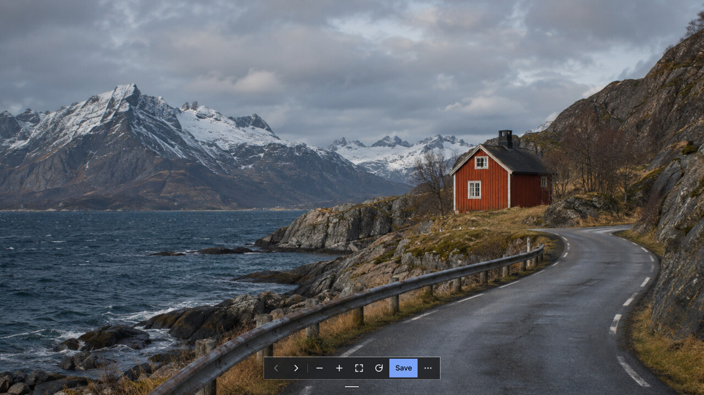

# Image Viewer

Image Viewer is a standalone Qt Quick app for browsing, zooming, and rotating
photos in local and mounted folders on Omarchy.



## Install, update, and uninstall

On Omarchy, the installer uses `makepkg` to build and install the Arch package
with its declared dependencies. Run it from your regular user account.

```bash
git clone https://github.com/grankko/omarchy-additions.git
cd omarchy-additions/apps/image-viewer
./bin/install
```

To update, run `git pull` in the checkout and rerun `./bin/install`.
To uninstall, run `sudo pacman -R omarchy-image-viewer`.

If the compiler runs out of memory, retry with `JOBS=1 ./bin/install`.
After updating, close and reopen Image Viewer to run the installed version.

## Use

Launch **Image Viewer** or choose it from the file manager’s **Open With** menu.
Hover over or focus the handle at the bottom of the window to reveal the dock.
Right-click the photo for more actions.

Opening another image from the file manager reuses the running viewer window.
If that window is already visible, focus stays in the file manager while the
picture updates. Launching Image Viewer without a file activates its window.
Unsaved rotations offer Save, Discard, and Cancel before switching images.
During an operation, the latest requested image waits for it to finish.

The package includes dependencies for JPEG, PNG, WebP, TIFF, GIF, BMP, HEIC,
AVIF, JPEG XL, and other image decoders. Use
`./build/omarchy-image-viewer --formats` to check the decoders on a source build.
Animated and multi-page images are shown as a first frame.

### Controls

| Input | Action |
| --- | --- |
| Left / Right | Previous or next image in natural filename order |
| Scroll or + / − | Zoom |
| Trackpad pinch | Zoom around the pointer |
| Drag | Pan while zoomed |
| 0 / 1 | Fit to window / actual size |
| R / Shift+R | Rotate right / left |
| Ctrl+S | Save the pending rotation to the current file |
| Ctrl+C | Copy the full-resolution image with its current rotation |
| Ctrl+O | Open a photo through the desktop file picker |
| Shift+F10 or right-click | Open the image menu, including Send to → LocalSend |
| F5 | Refresh the folder |
| ? / Q | Show shortcuts / close |

Use Omarchy’s **Super+F** for fullscreen.

**Save** becomes available for a supported image when its rotation differs from
the saved orientation. For ordinary JPEGs, the writer uses an exact lossless
pixel rotation when possible. For JPEGs with standard EXIF or dimensions that
would require cropping, it uses Exiv2 to update the orientation tag and
preserve the original pixels. Viewers that ignore EXIF will show the stored
pixel orientation. JPEGs with unsupported application markers and PNGs with
unsupported chunks remain view-only. The writer preserves qualified PNG
transparency, color profiles, text, and pixel density. It checks for file
changes and replaces the original from a temporary sibling. A disconnected
mount can leave the commit result uncertain, in which case the viewer asks for
a reload before another save.

### Mounted folders

Open a photo using its mounted path. The viewer lists the folder in the
background and reads ahead one neighbor at a time, in the direction of travel
first. A 48 MiB RAM cache holds decoded neighbor previews. The displayed photo
stays visible until the requested image is ready, and a warm preview is
rechecked in the background. After a failed read, press the arrow again to
continue past that entry. Fit drops the separate zoom detail buffer. **Refresh folder** clears the cache and updates
the list. **Reload image** requests a fresh read of the current file.

LocalSend receives the saved file at its filesystem path. With an unsaved
rotation, the viewer offers to save first or open LocalSend with the saved
version.

## Development

Source builds require Qt 6.12 or newer, qmake6, a C++ compiler, and make.
From this directory, run:

```bash
./bin/build
./bin/test
./build/omarchy-image-viewer -- /path/to/photo.jpg
./build/omarchy-image-viewer --inspect --json -- /path/to/photo.png
./build/omarchy-image-viewer --rotate 90 --json -- /path/to/disposable-photo.png
```

`--rotate` uses the same in-place writer as **Save**.

Use `./bin/source` to generate the local source archive used by makepkg. The
PKGBUILD pins its checksum. For implementation details and testing notes, see
the [architecture](docs/architecture.md) and [v0.2 QA report](docs/qa-v0.2.md).
The [v0.3 QA report](docs/qa-v0.3.md) covers launch forwarding and trackpad input.

Filesystem calls on a disconnected mount can block in the kernel. The viewer
can invalidate their results and keep unrelated worker lanes responsive.
A blocked foreground call can still delay the next cold read, and a blocked
worker can delay process exit. Save conflict checks use filesystem identity and
metadata, which can be cached by a remote client. The viewer verifies a
replacement before clearing the edit and reports directory-sync failures
separately from failed or uncertain replacements.
