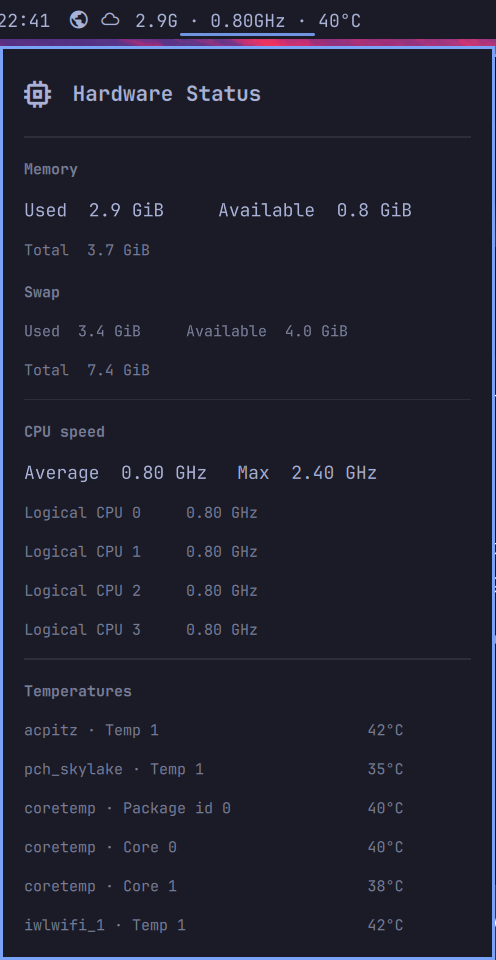

# Hardware Status

A small Omarchy bar widget showing memory used, average CPU speed,
and CPU temperature. Click it for logical-CPU frequencies, detected temperature
sensors, memory and swap details. The CPU section also shows the kernel-reported
maximum frequency, plus the configured limit if it is lower. Thermal and power
limits can keep the live speed below that reported maximum.

It never changes permissions or reads protected RAPL CPU power counters.



## Install, update, and uninstall

From a terminal in your Omarchy desktop session, run:

```bash
git clone https://github.com/grankko/omarchy-additions.git
cd omarchy-additions
./plugins/hardware-status/bin/install
```

To update, run `git pull` in the checkout and rerun the installer. To remove
the plugin, run `./plugins/hardware-status/bin/uninstall`.

The installer places it immediately after Weather in the `centerEnd` section,
next to the centered Clock. It backs up the existing shell configuration and
any prior copy of this plugin. It does not alter other plugins or bar entries.

## Runtime

One short Bash process samples `/proc/meminfo`, CPU frequency and hardware
temperature files under `/sys` every three seconds. It uses Bash built-ins for
file reads and launches no additional processes, services, Python interpreter,
or privileged helper. Missing metrics show as unavailable. Frequency is the
kernel's reported scaling frequency for each logical CPU; it may differ from
the exact instantaneous hardware clock.

## Hardware coverage

Built and checked on an Intel Core i3-7100U laptop with four logical CPUs,
about 4 GiB of RAM, and temperature readings from the `coretemp`, `acpitz`,
and `pch_skylake` drivers. Other machines may expose different sensors or no
readable CPU frequency or temperature data; missing readings appear as
unavailable. The plugin does not need root access.

## Development checks

```bash
node --test tests/*.test.cjs
bash -n plugins/hardware-status/scripts/sample plugins/hardware-status/bin/install plugins/hardware-status/bin/uninstall
omarchy plugin validate plugins/hardware-status
```
