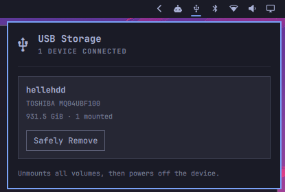

# USB Storage

USB Storage is an Omarchy bar plugin for checking connected USB drives and
safely disconnecting them.



## Install, update, and uninstall

You need Omarchy with support for schema version 1 shell plugins, UDisks2, and
a desktop Polkit agent. The installer checks for Bash helper dependencies
including `busctl`, `udisksctl`, `jq`, `flock`, `stdbuf`, and `notify-send`.

Omarchy Additions is an independent hobby project provided as is, without
warranty, under the [MIT License](../../LICENSE). The installer asks you to
acknowledge this before installing or updating USB Storage.

From a terminal in your Omarchy desktop session, run:

```bash
git clone https://github.com/grankko/omarchy-additions.git
cd omarchy-additions/plugins/usb-storage
./bin/install
```

To update, run `git pull` in the checkout and rerun `./bin/install`. The
installer validates and copies the plugin to
`~/.config/omarchy/plugins/grankko.usb-storage`, then enables it beside Bluetooth.
Omarchy reloads the widget automatically. Previous plugin files and bar
configuration are backed up under `~/.local/state/omarchy-additions/backups/`.

To uninstall, run `./bin/uninstall`. Omarchy removes the plugin and its bar
entry while preserving the rest of the bar layout.

## Use

When USB storage is connected, click the USB icon to see drive names, capacity,
and mount status. Choose **Safely Remove** to unmount the affected volumes and
power off the device. Wait for **Safe to unplug** before disconnecting it.

| Input | Action |
| --- | --- |
| Up / Down or J / K | Select a drive |
| Tab / Shift+Tab | Move focus between drives |
| Enter / Space | Remove the selected drive |
| Escape | Close the panel |

A busy volume stops removal. Close any files or terminals using that drive and
retry. If removal stops partway through, use Files to remount any volumes you
want to keep using.

A row can represent several drives that share a USB bridge or card reader. The
panel indicates when removal affects linked drives. It excludes internal
storage, system volumes, and network mounts. Removal is disabled for encrypted
mappings, RAID/LVM, unknown device identities, and drives without UDisks2
power-off support.

## Development

From the repository root, run:

```bash
node --test tests/*.test.cjs
for script in plugins/usb-storage/bin/* plugins/usb-storage/scripts/usb-storage; do
  bash -n "$script" || exit
done
omarchy plugin validate plugins/usb-storage
```

The tests use synthetic D-Bus data and fake commands. Testing live removal
requires selecting and authorizing a test drive. The runtime uses QML,
JavaScript, and Bash helpers. It rechecks device identity and volume state
before each unmount and power-off. See the
[UDisks2 drive API](https://storaged.org/doc/udisks2-api/latest/gdbus-org.freedesktop.UDisks2.Drive.html)
for how power-off affects linked drives.
